# DIAGRAMA DE CLASES UML

**Sistema de Gestión Académica y Planificación de Rutas**  
**Programación III – Proyecto Final**  

---

## 1. Diagrama General de Arquitectura y Clases

A continuación se presenta el modelo conceptual de clases UML utilizando sintaxis estándar Mermaid, reflejando fielmente la jerarquía de herencia y las estructuras de datos del proyecto:

```mermaid
classDiagram
    %% Jerarquía de Personas (Obligatoria: 1 abstracta y 2 hijas)
    class Persona {
        <<abstract>>
        -String id
        -String nombre
        -String email
        +mostrarInformacion()* String
        +getId() String
        +getNombre() String
        +getEmail() String
    }

    class Estudiante {
        -int semestre
        -Double[][] notas
        -String[][] materiasNombres
        -int[] conteoMateriasSemestre
        -List~String~ historialMaterias
        -List~String~ materiasInscritas
        +registrarNota(int, String, double) boolean
        +eliminarUltimaNota(int, String) boolean
        +calcularPromedioSemestre(int) double
        +calcularPromedioAcumulado() double
        +contarMateriasAprobadas() int
        +contarMateriasReprobadas() int
        +generarReporteAcademico() String
        +mostrarInformacion() String
    }

    class Profesor {
        -String departamento
        -double salario
        +mostrarInformacion() String
        +getDepartamento() String
        +getSalario() double
    }

    Persona <|-- Estudiante : Herencia
    Persona <|-- Profesor : Herencia

    %% Modelo Académico y Campus
    class Materia {
        -String codigo
        -String nombre
        -int cuposMaximos
        -int creditos
        -List~String~ prerequisitos
        -List~Estudiante~ inscritos
        -Queue~Estudiante~ colaEspera
        +agregarPrerequisito(String) boolean
        +cumplePrerequisitos(Estudiante) boolean
        +inscribirEstudiante(Estudiante) ResultadoInscripcion
        +cancelarInscripcion(String) ResultadoInscripcion
    }

    class Aula {
        -String codigo
        -int capacidad
        -boolean[][] horario
        +consultarDisponibilidad(int, int) boolean
        +reservar(int, int, int) void
        +liberar(int, int, int) void
    }

    class Facultad {
        -String codigo
        -String nombre
        -String decano
    }

    class SolicitudInscripcion {
        -String idEstudiante
        -String codigoMateria
        +getIdEstudiante() String
        +getCodigoMateria() String
    }

    %% Estructuras y Algoritmos
    class GrafoCampus {
        -int numEdificios
        -String[] nombresEdificios
        -int[][] matrizAdyacencia
        +agregarConexion(int, int, int) void
        +calcularRutaMasCorta(int, int) ResultadoRuta
    }

    class NavegadorReportes {
        -Stack~String~ pilaAtras
        -Stack~String~ pilaAdelante
        -String reporteActual
        +registrarReporte(String) void
        +retroceder() String
        +avanzar() String
    }

    %% Patrón Command / Memento para Deshacer/Rehacer
    class Operacion {
        <<interface>>
        +deshacer()* String
        +rehacer()* String
        +getDescripcion()* String
    }

    class HistorialOperaciones {
        -Stack~Operacion~ pilaDeshacer
        -Stack~Operacion~ pilaRehacer
        +registrarOperacion(Operacion) void
        +deshacer() String
        +rehacer() String
    }

    HistorialOperaciones o-- Operacion : Gestiona en Pilas

    %% Controlador / Fachada Central
    class SistemaAcademico {
        -Map~String,Estudiante~ estudiantes
        -Map~String,Aula~ aulas
        -Map~String,Materia~ materias
        -Facultad[] facultades
        -GrafoCampus grafoCampus
        -HistorialOperaciones historialOperaciones
        -NavegadorReportes navegadorReportes
        -Queue~SolicitudInscripcion~ colaBatch
        +registrarEstudiante(...) void
        +buscarEstudiante(String) Estudiante
        +inscribirEstudianteEnMateria(...) ResultadoInscripcion
        +cancelarInscripcionMateria(...) ResultadoInscripcion
        +reservarHorarioAula(...) void
        +calcularRutaMasCorta(...) ResultadoRuta
        +procesarArchivoBatch(String) ResumenBatch
    }

    SistemaAcademico o-- Estudiante : Contiene en HashMap
    SistemaAcademico o-- Aula : Contiene en TreeMap
    SistemaAcademico o-- Materia : Contiene en Map
    SistemaAcademico o-- Facultad : Contiene en Facultad[5]
    SistemaAcademico o-- GrafoCampus : Gestiona rutas con Dijkstra
    SistemaAcademico o-- HistorialOperaciones : Gestiona Undo/Redo
    SistemaAcademico o-- NavegadorReportes : Gestiona historial
    SistemaAcademico o-- SolicitudInscripcion : Procesa en Queue
```

---

## 2. Descripción de Relaciones Clave del Modelo

1. **Herencia Generalización (`Persona`):**  
   `Estudiante` y `Profesor` extienden de la clase abstracta `Persona`, heredando `id`, `nombre` y `email`, y sobrescribiendo polimórficamente `mostrarInformacion()`.
2. **Matrices Nativas Incrustadas:**  
   * `Estudiante` encapsula un arreglo estático bidimensional `Double[10][20]` para sus calificaciones semestrales.
   * `Aula` encapsula una matriz booleana nativa `boolean[7][24]` para el control de horas reservadas/libres.
   * `GrafoCampus` encapsula una matriz de adyacencia `int[N][N]` para las distancias entre edificios.
   * `SistemaAcademico` mantiene un arreglo estático `Facultad[5]`.
3. **Colecciones y Estructuras Dinámicas:**  
   * `Materia` contiene una `List<String>` de pre-requisitos, una `List<Estudiante>` de inscritos y una `Queue<Estudiante>` para la cola de espera de cupos llenos.
   * `SistemaAcademico` implementa un `HashMap<String, Estudiante>` para búsquedas en $O(1)$ y un `TreeMap<String, Aula>` para iteración ordenada por código.
4. **Patrón Command con Pilas (`Stack`):**  
   `HistorialOperaciones` administra dos pilas (`pilaDeshacer` y `pilaRehacer`) de objetos que implementan la interfaz `Operacion`, garantizando la reversibilidad exacta del estado del sistema.
